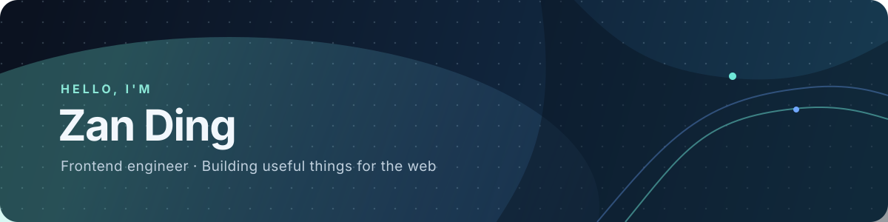
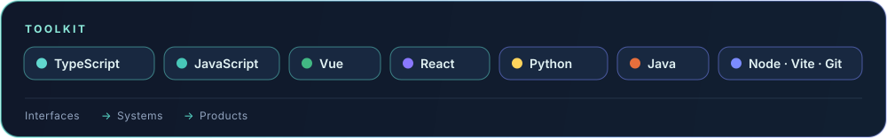
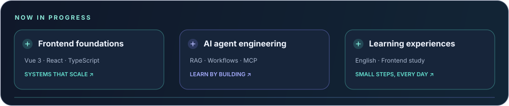

  

  <h1>Hi, I'm Zan Ding 👋</h1>
  
<strong>Frontend Engineer</strong> · Vue · React · TypeScript · AI Agents

  
Building frontend foundations, practical learning tools, and hands-on AI projects.

  
<a href="https://github.com/justinZan">⌁ &nbsp; Explore my repositories</a>

---

### About me

I build reusable frontend foundations and practical learning projects. My recent work spans Vue and React starter kits, AI agent development, and structured learning resources.

- 🧩 Building reusable **Vue 3** and **React** project foundations
- 🤖 Studying **AI agents**, **RAG**, **tool calling**, and **LLMOps** through hands-on projects
- 📚 Creating structured learning resources for English and frontend engineering

### Tech I use

  

### Selected projects

| Project | What it is | Built with |
| --- | --- | --- |
| [Vue3-seed](https://github.com/justinZan/Vue3-seed) | Vue 3 starter for admin apps, with routing, state, themes, i18n, auth, tests, and CI checks | Vue · TypeScript · Element Plus |
| [React-Seed](https://github.com/justinZan/React-Seed) | React starter for admin apps, with auth, dynamic menus, permissions, themes, and i18n | React · TypeScript |
| [AI-Agent-Learning](https://github.com/justinZan/AI-Agent-Learning) | A guided, hands-on path through agents, RAG, workflows, MCP, and multi-agent patterns | Python · LangGraph |
| [English-Learning](https://github.com/justinZan/English-Learning) | A 24-week English course with daily lessons, audio, exercises, search, and progress tracking | HTML · JavaScript |
| [Front-Interview](https://github.com/justinZan/Front-Interview) | Chinese frontend interview guide with 164 questions across Vue, TypeScript, real-time data, performance, and delivery | Vue · TypeScript · ECharts |

Also exploring: [LLMops](https://github.com/justinZan/LLMops), [Java todo API](https://github.com/justinZan/Java-todo-api), [Vue Violet Seed](https://github.com/justinZan/vue-violet-seed), and [Gauge Chart](https://github.com/justinZan/guage-chart).

### Currently building

  

  ✨ Building, learning, and sharing.

